# DATABASE.md — Struktur Database SubSenpai

Skema PostgreSQL SubSenpai — database berjalan **lokal di VPS** (bukan Supabase; alasan & konsekuensi aksesnya di Bagian 6) — dalam bentuk **diagram ERD**, detail kolom, relasi, indeks, dan draf SQL. Dokumen ini adalah pendalaman dari Bagian 3 [STRUKTUR.md](STRUKTUR.md) — bila ada perbedaan, yang berlaku adalah dokumen ini untuk urusan database.

## 1. Diagram ERD

Diagram di bawah dirender otomatis oleh GitHub (Mermaid).

```mermaid
erDiagram
    titles ||--o{ episodes : "judul video punya"
    titles ||--o{ chapters : "judul baca punya"
    chapters ||--o{ chapter_pages : "chapter berisi"
    episodes ||--o{ subtitles : "episode punya"
    profiles ||--o{ subscriptions : "user berlangganan"
    profiles ||--o{ watchlist : "user menyimpan"
    titles ||--o{ watchlist : "judul disimpan di"
    profiles ||--o{ watch_history : "user menonton"
    episodes ||--o{ watch_history : "episode ditonton"
    profiles ||--o{ read_history : "user membaca"
    chapters ||--o{ read_history : "chapter dibaca"
    titles ||--o{ guest_access : "judul diakses tamu"
    profiles ||--o{ reports : "user melaporkan"
    profiles ||--o{ admin_logs : "admin bertindak"
    profiles ||--o{ vouchers : "membuat / membeli"
    profiles ||--o{ vouchers : "menukar"
    profiles ||--o{ payment_sessions : "membayar"
    chat_channels ||--o{ chat_messages : "kanal berisi"
    profiles ||--o{ chat_messages : "mengirim"
    stickers ||--o{ chat_messages : "dipakai di"
    profiles ||--o{ user_stickers : "punya stiker pribadi"
    profiles ||--o{ friendships : "mengirim permintaan"
    profiles ||--o{ user_blocks : "memblokir"
    profiles ||--o{ groups : "membuat"
    groups ||--o{ group_members : "beranggotakan"
    profiles ||--o{ group_members : "bergabung"
    groups ||--o| chat_channels : "punya kanal chat"
    profiles ||--o{ comments : "menulis"
    episodes ||--o{ comments : "dikomentari"
    chapters ||--o{ comments : "dikomentari"
    profiles ||--o{ title_ratings : "menilai"
    titles ||--o{ title_ratings : "dinilai"
    profiles ||--o{ device_tokens : "perangkat"
    profiles ||--o{ notifications : "menerima"
    profiles ||--o{ broadcasts : "admin mengirim"
    profiles ||--o{ title_requests : "meminta judul"
    title_requests ||--o{ title_request_votes : "didukung"
    profiles ||--o{ title_request_votes : "memberi suara"
    profiles ||--o{ collections : "menyusun koleksi"
    collections ||--o{ collection_items : "berisi"
    titles ||--o{ collection_items : "masuk koleksi"
    profiles ||--o{ collection_follows : "mengikuti koleksi"
    collections ||--o{ collection_follows : "diikuti"
    profiles ||--o{ user_achievements : "membuka pencapaian"
    profiles ||--o{ user_devices : "perangkat akun"
    chat_messages ||--o{ chat_messages : "membalas"
    comments ||--o{ comments : "balasan"

    titles {
        uuid id PK
        text slug UK "untuk URL"
        text type "anime|donghua|film|manga|manhua|manhwa"
        text title
        text title_alt "judul asli JP/CN/KR"
        text synopsis
        text poster_url "R2"
        int year
        text season "khusus anime, boleh kosong"
        text status "ongoing|completed"
        text[] genres
        numeric rating
        boolean is_adult "konten 18+"
        timestamptz created_at
        timestamptz updated_at "sinkronisasi delta"
    }
    episodes {
        uuid id PK
        uuid title_id FK
        int episode_no "film = 1"
        text title
        text video_url "HLS dari sumber"
        int duration_sec
        date aired_at
        int intro_start_sec "penanda intro"
        int intro_end_sec
        int outro_start_sec "penanda outro"
        int outro_end_sec
        timestamptz updated_at "sinkronisasi delta"
    }
    chapters {
        uuid id PK
        uuid title_id FK
        numeric chapter_no "boleh desimal"
        text title
        int page_count
        timestamptz updated_at "sinkronisasi delta"
    }
    chapter_pages {
        uuid id PK
        uuid chapter_id FK
        int page_no
        text image_url "R2"
    }
    subtitles {
        uuid id PK
        uuid episode_id FK
        text lang "id|en"
        text source "caption|whisper"
        text format "srt|ass"
        text file_url "R2"
        text status "queued|processing|done|failed"
    }
    profiles {
        uuid id PK
        text email UK "dari akun Google"
        text google_sub UK "identitas Google"
        text display_name
        text avatar_url
        boolean is_premium "cache status"
        timestamptz premium_until
        text role "user|admin"
        text name_color "warna nickname chat (premium)"
        text name_emoji "emoji di nama chat (premium)"
        timestamptz chat_muted_until "bisukan chat s.d."
        text friend_code UK "kode teman + referral"
        int xp "poin aktivitas"
        int level "level aktivitas"
        boolean hide_adult "sembunyikan 18+"
        boolean is_banned "akun dinonaktifkan admin"
        boolean show_online "tampilkan status online"
        boolean show_activity "tampilkan aktivitas tonton/baca"
        timestamptz trial_used_at "trial premium pernah dipakai"
        date last_active_date "hari aktivitas terakhir"
        int streak_days "rentetan hari aktif"
    }
    subscriptions {
        uuid id PK
        uuid user_id FK
        text plan
        text status "active|expired|cancelled"
        timestamptz current_period_end
        text provider "midtrans|xendit|gopay|manual|voucher|trial"
        text provider_ref
    }
    watchlist {
        uuid user_id PK,FK
        uuid title_id PK,FK
        boolean notify "lonceng update judul ini"
        timestamptz created_at
    }
    watch_history {
        uuid user_id PK,FK
        uuid episode_id PK,FK
        int position_sec
        timestamptz updated_at
    }
    read_history {
        uuid user_id PK,FK
        uuid chapter_id PK,FK
        int last_page
        timestamptz updated_at
    }
    guest_access {
        uuid id PK
        text device_key "hash cookie/device"
        uuid title_id FK
        uuid episode_id FK "salah satu terisi"
        uuid chapter_id FK "salah satu terisi"
        timestamptz used_at
    }
    reports {
        uuid id PK
        uuid user_id FK "pelapor, boleh kosong"
        text target_kind "episode|chapter|subtitle|chat_message|group|comment"
        uuid target_id "id target yang dilaporkan"
        text reason
        text status "open|resolved|dismissed"
        timestamptz created_at
    }
    admin_logs {
        uuid id PK
        uuid admin_id FK
        text action "mis. premium_grant, subtitle_retry"
        text target "tabel:id yang diubah"
        jsonb detail
        timestamptz created_at
    }
    vouchers {
        uuid id PK
        text code UK "kode sekali pakai"
        text source "admin|purchase|referral"
        int duration_days "hari premium"
        text status "active|redeemed|expired|revoked"
        uuid created_by FK "admin / pembeli"
        uuid assigned_to FK "penerima tertentu, boleh kosong"
        uuid redeemed_by FK "penukar, kosong sblm ditukar"
        timestamptz redeemed_at
        timestamptz expires_at "batas tukar kode"
        text payment_ref "ref pembayaran pembeli"
        timestamptz created_at
    }
    payment_sessions {
        uuid id PK
        uuid user_id FK
        text purpose "subscription|voucher"
        text provider "gopay"
        int amount "total unik (harga + kode)"
        int unique_code "1-999"
        text status "pending|paid|expired"
        text matched_ref "id referensi GoPay"
        timestamptz expires_at
        timestamptz created_at
    }
    chat_channels {
        uuid id PK
        text slug UK
        text name
        text description
        int sort_order
        text kind "global|group|dm"
        uuid group_id FK "terisi bila kind=group"
        uuid dm_user_a_id FK "peserta DM 1, bila kind=dm"
        uuid dm_user_b_id FK "peserta DM 2, bila kind=dm"
    }
    chat_messages {
        uuid id PK
        uuid channel_id FK
        uuid user_id FK
        text kind "text|sticker|image|share"
        text body "isi teks, maks 500"
        uuid sticker_id FK "stiker katalog, bila kind=sticker"
        text image_url "URL ImgBB, bila image / stiker pribadi"
        text image_thumb_url "thumbnail ImgBB untuk daftar chat"
        uuid reply_to_id FK "pesan yang dibalas"
        uuid ref_title_id FK "judul kartu berbagi, bila kind=share"
        uuid ref_episode_id FK "episode kartu berbagi, bila ada"
        timestamptz created_at
        timestamptz deleted_at "soft-delete moderasi"
    }
    stickers {
        uuid id PK
        text pack
        text name
        text image_url "R2"
        boolean is_premium "khusus premium"
    }
    friendships {
        uuid requester_id PK,FK
        uuid addressee_id PK,FK
        text status "pending|accepted"
        timestamptz created_at
    }
    user_blocks {
        uuid blocker_id PK,FK
        uuid blocked_id PK,FK
        timestamptz created_at
    }
    groups {
        uuid id PK
        text name
        text description
        text avatar_url "R2"
        uuid owner_id FK
        boolean is_public
        text invite_code UK "kode tautan undangan grup"
        boolean invite_enabled "penerimaan via tautan aktif"
        timestamptz created_at
    }
    group_members {
        uuid group_id PK,FK
        uuid user_id PK,FK
        text role "owner|admin|member"
        timestamptz joined_at
    }
    user_stickers {
        uuid id PK
        uuid user_id FK
        text image_url "URL ImgBB"
        text thumb_url "thumbnail ImgBB"
        text delete_url "internal server saja"
        timestamptz created_at
    }
    comments {
        uuid id PK
        uuid user_id FK
        uuid episode_id FK "salah satu terisi"
        uuid chapter_id FK "salah satu terisi"
        uuid parent_id FK "komentar induk, bila ini balasan"
        text body
        timestamptz created_at
        timestamptz deleted_at "soft-delete moderasi"
    }
    title_ratings {
        uuid user_id PK,FK
        uuid title_id PK,FK
        int score "1-10"
        text review
        timestamptz created_at
    }
    device_tokens {
        uuid user_id PK,FK
        text fcm_token PK
        text platform "android"
        timestamptz updated_at
    }
    daily_stats {
        date day PK
        int views "tontonan hari itu"
        int reads "bacaan hari itu"
        int new_users
        int chat_messages
    }
    notifications {
        uuid id PK
        uuid user_id FK
        text kind "release|broadcast|system"
        text title
        text body
        uuid ref_title_id FK "judul terkait, bila ada"
        uuid broadcast_id FK "sumber broadcast, bila ada"
        timestamptz read_at
        timestamptz created_at
    }
    broadcasts {
        uuid id PK
        uuid admin_id FK
        text audience "all|premium|free"
        text title
        text body
        uuid ref_title_id FK "tautan ke judul/promo, bila ada"
        int sent_count
        timestamptz created_at
    }
    title_requests {
        uuid id PK
        uuid requester_id FK
        text title_text "judul yang diminta"
        text type "tipe konten yang diminta"
        text note
        text status "pending|approved|added|rejected"
        uuid matched_title_id FK "judul katalog hasil pemenuhan"
        timestamptz created_at
    }
    title_request_votes {
        uuid request_id PK,FK
        uuid user_id PK,FK
        timestamptz created_at
    }
    collections {
        uuid id PK
        uuid owner_id FK
        text name
        text description
        boolean is_public
        timestamptz created_at
    }
    collection_items {
        uuid collection_id PK,FK
        uuid title_id PK,FK
        int position "urutan tampil"
    }
    collection_follows {
        uuid collection_id PK,FK
        uuid user_id PK,FK
        timestamptz created_at
    }
    user_achievements {
        uuid user_id PK,FK
        text achievement_key PK "kunci pencapaian (definisi di kode)"
        timestamptz unlocked_at
    }
    user_devices {
        uuid id PK
        uuid user_id FK
        text device_id "id perangkat dari aplikasi"
        text device_name
        timestamptz last_seen_at
        timestamptz revoked_at "terisi = sesi dicabut"
        timestamptz created_at
    }
```



Catatan: tidak ada layanan auth eksternal — `profiles` adalah tabel user itu sendiri. Login **wajib Google**: backend memverifikasi token ID Google, mencocokkan user lewat `google_sub` yang unik, lalu menerbitkan JWT sesinya sendiri. Kata sandi tidak pernah disimpan di mana pun (tidak ada pendaftaran email/password).

## 2. Ringkasan Tabel

| Tabel | Isi | Kelompok |
| --- | --- | --- |
| `titles` | Katalog semua konten (satu tabel, dibedakan kolom `type`) | Katalog |
| `episodes` | Episode video untuk anime/donghua/film | Katalog |
| `chapters` | Chapter untuk manga/manhua/manhwa | Katalog |
| `chapter_pages` | Halaman gambar per chapter | Katalog |
| `subtitles` | File subtitle per episode + status antrean worker | Katalog |
| `profiles` | Tabel user (identitas Google: email + google_sub) + profil + cache status premium | User |
| `subscriptions` | Langganan premium & status pembayaran | Monetisasi |
| `watchlist` | Judul favorit user + saklar notifikasi per judul (`notify`) | User |
| `notifications` | Kotak masuk notifikasi user (rilis baru, broadcast admin, sistem) | Sistem |
| `broadcasts` | Pengumuman manual admin (promo/event) + audiens & jumlah terkirim | Admin |
| `watch_history` | Posisi tontonan terakhir per episode | User |
| `read_history` | Halaman terakhir per chapter | User |
| `guest_access` | Jejak akses tamu untuk menegakkan batas 1 episode/chapter | Akses |
| `reports` | Laporan user soal konten rusak (link mati, subtitle salah) | Admin |
| `admin_logs` | Jejak audit aksi admin di panel | Admin |
| `vouchers` | Kode voucher premium — dibuat admin (promo) atau dibeli user untuk dihadiahkan | Monetisasi |
| `payment_sessions` | Sesi pembayaran jalur polling (GoPay pihak ketiga): nominal unik, status, batas waktu | Monetisasi |
| `chat_channels` | Kanal chat: global (Umum, Anime, Donghua, Manga, Rekomendasi), grup, dan DM antar teman | Komunitas |
| `chat_messages` | Pesan Chat Global (teks / stiker), soft-delete untuk moderasi | Komunitas |
| `stickers` | Katalog stiker chat (sebagian khusus premium) | Komunitas |
| `friendships` | Pertemanan antar-user (permintaan + status) | Sosial |
| `user_blocks` | Blokir antar-user (menolak permintaan & undangan) | Sosial |
| `groups` | Grup buatan user (publik/privat, pemilik, avatar, kode tautan undangan) | Sosial |
| `group_members` | Keanggotaan grup + peran (owner/admin/member) | Sosial |
| `user_stickers` | Stiker pribadi buatan user — gambar dihosting di ImgBB, DB hanya menyimpan URL | Komunitas |
| `comments` | Komentar user per episode / chapter | Komunitas |
| `title_ratings` | Rating (1–10) & ulasan user per judul; agregatnya mengisi `titles.rating` | Komunitas |
| `device_tokens` | Token FCM per perangkat untuk notifikasi rilis baru | Sistem |
| `daily_stats` | Agregat harian (tontonan, bacaan, user baru, pesan) untuk dashboard admin | Sistem |
| `title_requests` | Permintaan judul yang belum ada di katalog + status tindak lanjut admin | Komunitas |
| `title_request_votes` | Suara dukungan user per permintaan judul (satu suara per user) | Komunitas |
| `collections` | Koleksi kurasi buatan user (daftar judul bertema, publik/privat) | Komunitas |
| `collection_items` | Isi koleksi: judul + urutan tampil | Komunitas |
| `collection_follows` | User yang mengikuti sebuah koleksi | Komunitas |
| `user_achievements` | Pencapaian yang sudah dibuka user (kunci pencapaian + waktu) | User |
| `user_devices` | Registri perangkat per akun — batas perangkat premium & keamanan sesi | Sistem |

## 3. Relasi (Foreign Key)

- `episodes.title_id → titles.id` (hapus judul = hapus episode: `ON DELETE CASCADE`)
- `chapters.title_id → titles.id` (CASCADE)
- `chapter_pages.chapter_id → chapters.id` (CASCADE)
- `subtitles.episode_id → episodes.id` (CASCADE)
- `profiles` adalah tabel user itu sendiri (tanpa FK ke layanan auth eksternal); identitas Google dicocokkan lewat kolom `google_sub` yang unik
- `subscriptions.user_id → profiles.id` (CASCADE)
- `watchlist (user_id, title_id)` — kunci utama gabungan
- `watch_history (user_id, episode_id)` — kunci utama gabungan
- `read_history (user_id, chapter_id)` — kunci utama gabungan
- `guest_access` — `title_id` selalu terisi; tepat satu dari `episode_id` / `chapter_id` terisi
- `reports.user_id → profiles.id` (boleh kosong untuk laporan tamu; `ON DELETE SET NULL`) — target laporan bersifat polimorfik lewat (`target_kind`, `target_id`), tanpa FK keras
- `admin_logs.admin_id → profiles.id`
- `vouchers.created_by → profiles.id` (admin pembuat / user pembeli); `vouchers.assigned_to → profiles.id` (boleh kosong = siapa saja boleh menukar); `vouchers.redeemed_by → profiles.id` (kosong sampai ditukar)
- `payment_sessions.user_id → profiles.id`; target bayarnya (langganan/voucher) dicocokkan lewat `purpose` + konteks sesi, referensi hasil pencocokan disimpan di `matched_ref`
- `chat_messages.channel_id → chat_channels.id`; `chat_messages.user_id → profiles.id`; `chat_messages.sticker_id → stickers.id` (hanya terisi untuk pesan stiker)
- `friendships (requester_id, addressee_id)` — kunci utama gabungan; kedua FK ke `profiles.id` (relasi user-ke-user); satu baris per pasangan (arah = siapa yang meminta)
- `user_blocks (blocker_id, blocked_id)` — kunci utama gabungan, kedua FK ke `profiles.id`
- `groups.owner_id → profiles.id`; `group_members (group_id, user_id)` — kunci utama gabungan; `chat_channels.group_id → groups.id` (unik — satu grup satu kanal chat); `groups.invite_code` unik — membentuk tautan undangan resmi aplikasi yang boleh dibagikan semua anggota ke luar aplikasi; mengatur ulang kode membatalkan tautan lama
- `user_stickers.user_id → profiles.id`; gambarnya sendiri TIDAK disimpan di DB — hanya `image_url` (ImgBB) + `delete_url` internal untuk moderasi
- `comments.user_id → profiles.id`; tepat satu dari `comments.episode_id` / `comments.chapter_id` terisi; `comments.parent_id → comments.id` (balasan **satu tingkat**: balasan atas balasan menempel ke induk yang sama, tidak bersarang lebih dalam)
- `chat_messages.reply_to_id → chat_messages.id` (pesan yang dibalas; `ON DELETE SET NULL` — balasan tetap ada walau pesan asli dihapus); `chat_messages.ref_title_id / ref_episode_id` terisi hanya untuk pesan kartu berbagi (`kind = share`)
- `title_ratings (user_id, title_id)` — kunci utama gabungan (satu penilaian per user per judul, bisa diubah)
- `device_tokens (user_id, fcm_token)` — kunci utama gabungan; `daily_stats` tanpa FK (agregat sistem)
- `notifications.user_id → profiles.id`; `notifications.broadcast_id → broadcasts.id` (kosong untuk notifikasi rilis/sistem); `broadcasts.admin_id → profiles.id`; `ref_title_id` di keduanya menunjuk `titles.id` bila notifikasi terkait judul tertentu
- `title_requests.requester_id → profiles.id`; `title_requests.matched_title_id → titles.id` (terisi saat permintaan dipenuhi menjadi judul katalog); `title_request_votes (request_id, user_id)` — kunci utama gabungan (satu suara per user per permintaan)
- `collections.owner_id → profiles.id`; `collection_items (collection_id, title_id)` — kunci utama gabungan, `position` menentukan urutan tampil; `collection_follows (collection_id, user_id)` — kunci utama gabungan
- `user_achievements (user_id, achievement_key)` — kunci utama gabungan; definisi pencapaian (nama, ikon, syarat) hidup di kode aplikasi, bukan tabel, agar mudah ditambah tanpa migrasi
- `user_devices.user_id → profiles.id`; `device_id` unik per user — perangkat yang `revoked_at`-nya terisi tidak dihitung dalam batas perangkat premium dan sesi perangkat itu ditolak API
- Kanal DM memakai `chat_channels.kind = 'dm'` dengan `dm_user_a_id` & `dm_user_b_id` (kedua FK ke `profiles.id`, disimpan terurut a < b agar satu pasangan teman hanya punya satu kanal); hanya kedua peserta itu yang boleh membaca/menulis kanalnya

## 4. Nilai yang Dibatasi (cek/enum)

- `titles.type` ∈ `anime, donghua, film, manga, manhua, manhwa`
- `titles.status` ∈ `ongoing, completed`
- `subtitles.lang` ∈ `id, en` (Indonesia utama; Inggris hanya bila sumber bercaption Inggris); `subtitles.source` ∈ `caption, whisper`; `subtitles.status` ∈ `queued, processing, done, failed`
- `subscriptions.status` ∈ `active, expired, cancelled`; `subscriptions.provider` ∈ `midtrans, xendit, gopay, manual, voucher, trial` (`gopay` = GoPay Merchant API pihak ketiga, konfirmasi via polling; `manual` = diberi admin dari panel; `voucher` = hasil penukaran kode voucher; `trial` = uji coba premium gratis 3 hari, sekali per akun, ditandai `profiles.trial_used_at`)
- `payment_sessions.purpose` ∈ `subscription, voucher`; `payment_sessions.status` ∈ `pending, paid, expired`
- `vouchers.source` ∈ `admin, purchase, referral`; `vouchers.status` ∈ `active, redeemed, expired, revoked`
- `profiles.role` ∈ `user, admin`
- `reports.target_kind` ∈ `episode, chapter, subtitle, chat_message, group, comment`; `reports.status` ∈ `open, resolved, dismissed`
- `title_ratings.score` ∈ 1–10
- `notifications.kind` ∈ `release, broadcast, system`; `broadcasts.audience` ∈ `all, premium, free`
- `chat_messages.kind` ∈ `text, sticker, image, share` (teks → `body`; stiker katalog → `sticker_id`; gambar & stiker pribadi → `image_url` berisi URL ImgBB; kartu berbagi → `ref_title_id`)
- `chat_channels.kind` ∈ `global, group, dm` (`group_id` wajib terisi bila `group`; `dm_user_a_id`/`dm_user_b_id` wajib terisi bila `dm`; keduanya kosong bila `global`)
- `title_requests.type` mengikuti nilai `titles.type`; `title_requests.status` ∈ `pending, approved, added, rejected`
- `episodes` penanda intro/outro: bila kedua ujung terisi, ujung selesai harus lebih besar dari ujung mulai (`intro_end_sec > intro_start_sec`, `outro_end_sec > outro_start_sec`)
- `user_devices`: perangkat aktif = `revoked_at` kosong; user premium dibatasi maks **2 perangkat aktif** (ditegakkan API saat perangkat baru mendaftar, bukan di skema)
- `friendships.status` ∈ `pending, accepted`; `group_members.role` ∈ `owner, admin, member`

## 5. Indeks Penting

- `titles.slug` — unik (URL)
- `titles (type, created_at desc)` — telusur per tipe
- `titles.genres` — indeks GIN (filter genre)
- `episodes (title_id, episode_no)` — unik
- `chapters (title_id, chapter_no)` — unik
- `chapter_pages (chapter_id, page_no)` — unik
- `subtitles (episode_id, lang)` — unik (satu subtitle per bahasa per episode)
- `watch_history (user_id, updated_at desc)` — "lanjutkan menonton"
- `read_history (user_id, updated_at desc)` — "lanjutkan membaca"
- `guest_access (device_key)` — cek batas tamu
- `chat_messages (channel_id, created_at desc)` — riwayat & muat pesan per kanal
- `profiles.friend_code` — unik (pencarian teman lewat kode)
- `group_members (user_id)` — daftar grup milik seorang user; `groups (name)` — pencarian grup
- `titles` — indeks GIN di atas kolom `search_tsv` (`tsvector` dari `title` + `title_alt`, diperbarui trigger) untuk pencarian full-text; semua daftar besar (katalog, chat, komentar) memakai **pagination cursor** (`created_at`/`id`), bukan `OFFSET`
- `comments (episode_id, created_at desc)` & `comments (chapter_id, created_at desc)`
- `titles (updated_at)`, `episodes (updated_at)`, `chapters (updated_at)` — penanda waktu untuk **sinkronisasi delta** katalog ke penyimpanan lokal aplikasi (ambil hanya yang berubah sejak sinkron terakhir)
- `chat_channels (dm_user_a_id, dm_user_b_id)` — unik parsial khusus `kind = 'dm'` (satu kanal DM per pasangan teman)
- `title_requests (status, created_at desc)` — antrean permintaan judul untuk panel admin (urutan suara dihitung dari `title_request_votes`); `collections (owner_id)`; `collection_items (collection_id, position)`; `user_devices (user_id)`

## 6. Kontrol Akses Data (tanpa Supabase)

Database berjalan **lokal di VPS** dan hanya mendengarkan **localhost** — satu-satunya pemegang kredensial database adalah backend Go & worker di mesin yang sama. Aplikasi Android tidak pernah menyentuh database secara langsung (semua lewat API), jadi tidak ada Row Level Security: aturan kepemilikan ditegakkan **backend di setiap query**, dengan id user selalu diambil dari JWT sesi yang sudah diverifikasi — tidak pernah dari input klien.

- **Katalog** (`titles`, `episodes`, `chapters`, `chapter_pages`, `subtitles`): dibaca publik lewat API; tulis hanya oleh backend (impor katalog & worker). Akses menonton tetap digerbang di API (Bagian 4 STRUKTUR.md), bukan di database.
- **Milik user** (`profiles`, `subscriptions`, `watchlist`, `watch_history`, `read_history`, `user_devices`, `user_achievements`, `notifications`): query backend selalu difilter ke pemilik sesi; `subscriptions` hanya diubah backend (webhook/polling pembayaran & aksi admin), user cukup membaca statusnya.
- **`guest_access`**: hanya backend (ditulis & dicek oleh API).
- **`reports`**: user login bisa membuat laporan atas namanya; membaca & mengubah status hanya admin (role dicek backend dari `profiles.role`). **`admin_logs`** & **`broadcasts`**: ditulis backend dari aksi admin, dibaca hanya admin.
- **`vouchers`**: user membaca voucher yang ia buat/beli atau yang ditujukan kepadanya; penukaran dan penerbitan voucher pembelian hanya lewat API agar atomik dan tidak bisa diakali; admin membaca semua.
- **`payment_sessions`**: ditulis & diperbarui hanya oleh backend (termasuk proses polling); user hanya membaca sesi miliknya untuk melihat status pembayaran.
- **Chat**: `chat_channels` & `stickers` dibaca user login; `chat_messages` ditulis hanya atas nama pengirim dari sesi (tidak bisa mengatasnamakan user lain), dan penghapusan (soft-delete) hanya oleh admin/mod — atau admin grup di kanal grupnya. Kanal grup hanya bisa dibaca/ditulis anggotanya; kanal DM hanya oleh kedua pesertanya (dicek backend dari `group_members` / kolom peserta DM). Kolom kustomisasi premium di `profiles` (`name_color`, `name_emoji`) hanya bisa diubah lewat API yang memeriksa status premium di server.
- **Sosial**: `friendships` & `user_blocks` hanya terlihat oleh kedua pihak yang terlibat; perubahan (kirim/terima/tolak/blokir) lewat API. `groups` publik bisa dibaca semua user login; grup privat hanya oleh anggotanya — kecuali pemegang **tautan undangan resmi** grup (`invite_code` aktif), yang memang diizinkan bergabung lewat tautan itu.
- **`user_stickers` & gambar chat**: dikelola pemiliknya lewat API (unggah selalu lewat backend — kunci API ImgBB tidak pernah ke klien). Kolom `delete_url` (ImgBB) bersifat internal server: tidak pernah dipilih untuk dikirim ke aplikasi, hanya dipakai admin saat menghapus gambar yang melanggar.
- **`comments` & `title_ratings`**: dibaca user login; ditulis/diubah hanya milik sendiri lewat API; penghapusan komentar (soft-delete) juga oleh admin/mod. **`device_tokens`**: hanya pemiliknya & backend (pengirim notifikasi). **`daily_stats`**: ditulis worker agregasi, dibaca admin.
- **Koleksi & permintaan judul**: `collections` publik dibaca semua user login; koleksi privat hanya oleh pemilik & pengikutnya (`collection_items`/`collection_follows` mengikuti visibilitas koleksinya). `title_requests` & `title_request_votes` dibaca user login (permintaan bersifat publik agar bisa didukung), ditulis atas nama sendiri lewat API.

## 7. Draf SQL (titik awal migrasi)

```sql
create table titles (
  id uuid primary key default gen_random_uuid(),
  slug text not null unique,
  type text not null check (type in ('anime','donghua','film','manga','manhua','manhwa')),
  title text not null,
  title_alt text,
  synopsis text,
  poster_url text,
  year int,
  season text check (season in ('winter','spring','summer','fall')),
  status text not null default 'ongoing' check (status in ('ongoing','completed')),
  genres text[] not null default '{}',
  rating numeric,
  is_adult boolean not null default false,
  search_tsv tsvector generated always as (
    to_tsvector('simple', coalesce(title, '') || ' ' || coalesce(title_alt, ''))
  ) stored,
  created_at timestamptz not null default now(),
  updated_at timestamptz not null default now()
);
create index titles_search_idx on titles using gin (search_tsv);
create index titles_type_idx on titles (type, created_at desc);
create index titles_genres_idx on titles using gin (genres);
create index titles_updated_idx on titles (updated_at);

create table episodes (
  id uuid primary key default gen_random_uuid(),
  title_id uuid not null references titles(id) on delete cascade,
  episode_no int not null,
  title text,
  video_url text not null,
  duration_sec int,
  aired_at date,
  intro_start_sec int,
  intro_end_sec int,
  outro_start_sec int,
  outro_end_sec int,
  updated_at timestamptz not null default now(),
  unique (title_id, episode_no),
  check (intro_start_sec is null or intro_end_sec is null or intro_end_sec > intro_start_sec),
  check (outro_start_sec is null or outro_end_sec is null or outro_end_sec > outro_start_sec)
);
create index episodes_updated_idx on episodes (updated_at);

create table chapters (
  id uuid primary key default gen_random_uuid(),
  title_id uuid not null references titles(id) on delete cascade,
  chapter_no numeric not null,
  title text,
  page_count int not null default 0,
  updated_at timestamptz not null default now(),
  unique (title_id, chapter_no)
);
create index chapters_updated_idx on chapters (updated_at);

create table chapter_pages (
  id uuid primary key default gen_random_uuid(),
  chapter_id uuid not null references chapters(id) on delete cascade,
  page_no int not null,
  image_url text not null,
  unique (chapter_id, page_no)
);

create table subtitles (
  id uuid primary key default gen_random_uuid(),
  episode_id uuid not null references episodes(id) on delete cascade,
  lang text not null default 'id' check (lang in ('id','en')),
  source text not null check (source in ('caption','whisper')),
  format text not null default 'srt' check (format in ('srt','ass')),
  file_url text,
  status text not null default 'queued' check (status in ('queued','processing','done','failed')),
  unique (episode_id, lang)
);

create table profiles (
  id uuid primary key default gen_random_uuid(),
  email text unique,
  google_sub text unique,
  display_name text,
  avatar_url text,
  is_premium boolean not null default false,
  premium_until timestamptz,
  role text not null default 'user' check (role in ('user','admin')),
  name_color text,
  name_emoji text,
  chat_muted_until timestamptz,
  friend_code text unique,
  xp int not null default 0,
  level int not null default 1,
  hide_adult boolean not null default true,
  show_online boolean not null default true,
  show_activity boolean not null default true,
  trial_used_at timestamptz,
  last_active_date date,
  streak_days int not null default 0,
  is_banned boolean not null default false
);

create table subscriptions (
  id uuid primary key default gen_random_uuid(),
  user_id uuid not null references profiles(id) on delete cascade,
  plan text not null,
  status text not null default 'active' check (status in ('active','expired','cancelled')),
  current_period_end timestamptz,
  provider text check (provider in ('midtrans','xendit','gopay','manual','voucher','trial')),
  provider_ref text
);

create table watchlist (
  user_id uuid not null references profiles(id) on delete cascade,
  title_id uuid not null references titles(id) on delete cascade,
  notify boolean not null default false,
  created_at timestamptz not null default now(),
  primary key (user_id, title_id)
);

create table watch_history (
  user_id uuid not null references profiles(id) on delete cascade,
  episode_id uuid not null references episodes(id) on delete cascade,
  position_sec int not null default 0,
  updated_at timestamptz not null default now(),
  primary key (user_id, episode_id)
);
create index watch_history_user_idx on watch_history (user_id, updated_at desc);

create table read_history (
  user_id uuid not null references profiles(id) on delete cascade,
  chapter_id uuid not null references chapters(id) on delete cascade,
  last_page int not null default 1,
  updated_at timestamptz not null default now(),
  primary key (user_id, chapter_id)
);
create index read_history_user_idx on read_history (user_id, updated_at desc);

create table guest_access (
  id uuid primary key default gen_random_uuid(),
  device_key text not null,
  title_id uuid not null references titles(id) on delete cascade,
  episode_id uuid references episodes(id) on delete cascade,
  chapter_id uuid references chapters(id) on delete cascade,
  used_at timestamptz not null default now(),
  check ((episode_id is not null) <> (chapter_id is not null))
);
create index guest_access_device_idx on guest_access (device_key);

create table reports (
  id uuid primary key default gen_random_uuid(),
  user_id uuid references profiles(id) on delete set null,
  target_kind text not null check (target_kind in ('episode','chapter','subtitle','chat_message','group','comment')),
  target_id uuid not null,
  reason text not null,
  status text not null default 'open' check (status in ('open','resolved','dismissed')),
  created_at timestamptz not null default now()
);
create index reports_status_idx on reports (status, created_at desc);

create table admin_logs (
  id uuid primary key default gen_random_uuid(),
  admin_id uuid not null references profiles(id) on delete cascade,
  action text not null,
  target text,
  detail jsonb,
  created_at timestamptz not null default now()
);
create index admin_logs_admin_idx on admin_logs (admin_id, created_at desc);

create table vouchers (
  id uuid primary key default gen_random_uuid(),
  code text not null unique,
  source text not null check (source in ('admin','purchase','referral')),
  duration_days int not null check (duration_days > 0),
  status text not null default 'active' check (status in ('active','redeemed','expired','revoked')),
  created_by uuid not null references profiles(id) on delete cascade,
  assigned_to uuid references profiles(id) on delete set null,
  redeemed_by uuid references profiles(id) on delete set null,
  redeemed_at timestamptz,
  expires_at timestamptz,
  payment_ref text,
  created_at timestamptz not null default now()
);
create index vouchers_status_idx on vouchers (status, created_at desc);

create table payment_sessions (
  id uuid primary key default gen_random_uuid(),
  user_id uuid not null references profiles(id) on delete cascade,
  purpose text not null check (purpose in ('subscription','voucher')),
  provider text not null default 'gopay',
  amount int not null check (amount > 0),
  unique_code int not null check (unique_code between 1 and 999),
  status text not null default 'pending' check (status in ('pending','paid','expired')),
  matched_ref text,
  expires_at timestamptz not null,
  created_at timestamptz not null default now()
);
-- nominal unik tidak boleh dipakai dua sesi aktif sekaligus
create unique index payment_sessions_amount_pending_idx
  on payment_sessions (provider, amount) where status = 'pending';

create table chat_channels (
  id uuid primary key default gen_random_uuid(),
  slug text not null unique,
  name text not null,
  description text,
  sort_order int not null default 0,
  kind text not null default 'global' check (kind in ('global','group','dm')),
  group_id uuid,
  dm_user_a_id uuid references profiles(id) on delete cascade,
  dm_user_b_id uuid references profiles(id) on delete cascade,
  unique (group_id),
  check (
    (kind = 'group' and group_id is not null and dm_user_a_id is null and dm_user_b_id is null)
    or (kind = 'dm' and group_id is null and dm_user_a_id is not null and dm_user_b_id is not null and dm_user_a_id < dm_user_b_id)
    or (kind = 'global' and group_id is null and dm_user_a_id is null and dm_user_b_id is null)
  )
);
create unique index chat_channels_dm_pair_idx on chat_channels (dm_user_a_id, dm_user_b_id) where kind = 'dm';

create table stickers (
  id uuid primary key default gen_random_uuid(),
  pack text not null,
  name text not null,
  image_url text not null,
  is_premium boolean not null default false
);

create table chat_messages (
  id uuid primary key default gen_random_uuid(),
  channel_id uuid not null references chat_channels(id) on delete cascade,
  user_id uuid not null references profiles(id) on delete cascade,
  kind text not null default 'text' check (kind in ('text','sticker','image','share')),
  body text check (char_length(body) <= 500),
  sticker_id uuid references stickers(id) on delete set null,
  image_url text,
  image_thumb_url text,
  image_delete_url text,
  reply_to_id uuid references chat_messages(id) on delete set null,
  ref_title_id uuid references titles(id) on delete set null,
  ref_episode_id uuid references episodes(id) on delete set null,
  created_at timestamptz not null default now(),
  deleted_at timestamptz,
  check (
    (kind = 'text' and body is not null)
    or (kind = 'sticker' and (sticker_id is not null or image_url is not null))
    or (kind = 'image' and image_url is not null)
    or (kind = 'share' and ref_title_id is not null)
  )
);
create index chat_messages_channel_idx on chat_messages (channel_id, created_at desc);

create table friendships (
  requester_id uuid not null references profiles(id) on delete cascade,
  addressee_id uuid not null references profiles(id) on delete cascade,
  status text not null default 'pending' check (status in ('pending','accepted')),
  created_at timestamptz not null default now(),
  primary key (requester_id, addressee_id),
  check (requester_id <> addressee_id)
);

create table user_blocks (
  blocker_id uuid not null references profiles(id) on delete cascade,
  blocked_id uuid not null references profiles(id) on delete cascade,
  created_at timestamptz not null default now(),
  primary key (blocker_id, blocked_id),
  check (blocker_id <> blocked_id)
);

create table groups (
  id uuid primary key default gen_random_uuid(),
  name text not null,
  description text,
  avatar_url text,
  owner_id uuid not null references profiles(id) on delete cascade,
  is_public boolean not null default true,
  invite_code text unique,
  invite_enabled boolean not null default true,
  created_at timestamptz not null default now()
);
create index groups_name_idx on groups (name);

create table group_members (
  group_id uuid not null references groups(id) on delete cascade,
  user_id uuid not null references profiles(id) on delete cascade,
  role text not null default 'member' check (role in ('owner','admin','member')),
  joined_at timestamptz not null default now(),
  primary key (group_id, user_id)
);
create index group_members_user_idx on group_members (user_id);

-- FK kanal chat grup (tabel groups baru ada setelah chat_channels dibuat)
alter table chat_channels
  add constraint chat_channels_group_fk
  foreign key (group_id) references groups(id) on delete cascade;

create table user_stickers (
  id uuid primary key default gen_random_uuid(),
  user_id uuid not null references profiles(id) on delete cascade,
  image_url text not null,
  thumb_url text,
  delete_url text,
  created_at timestamptz not null default now()
);
create index user_stickers_user_idx on user_stickers (user_id, created_at desc);

create table comments (
  id uuid primary key default gen_random_uuid(),
  user_id uuid not null references profiles(id) on delete cascade,
  episode_id uuid references episodes(id) on delete cascade,
  chapter_id uuid references chapters(id) on delete cascade,
  parent_id uuid references comments(id) on delete cascade,
  body text not null,
  created_at timestamptz not null default now(),
  deleted_at timestamptz,
  check ((episode_id is not null) <> (chapter_id is not null))
);
create index comments_episode_idx on comments (episode_id, created_at desc);
create index comments_chapter_idx on comments (chapter_id, created_at desc);

create table title_ratings (
  user_id uuid not null references profiles(id) on delete cascade,
  title_id uuid not null references titles(id) on delete cascade,
  score int not null check (score between 1 and 10),
  review text,
  created_at timestamptz not null default now(),
  primary key (user_id, title_id)
);

create table device_tokens (
  user_id uuid not null references profiles(id) on delete cascade,
  fcm_token text not null,
  platform text not null default 'android',
  updated_at timestamptz not null default now(),
  primary key (user_id, fcm_token)
);

create table daily_stats (
  day date primary key,
  views int not null default 0,
  reads int not null default 0,
  new_users int not null default 0,
  chat_messages int not null default 0
);

create table broadcasts (
  id uuid primary key default gen_random_uuid(),
  admin_id uuid not null references profiles(id) on delete cascade,
  audience text not null default 'all' check (audience in ('all','premium','free')),
  title text not null,
  body text not null,
  ref_title_id uuid references titles(id) on delete set null,
  sent_count int not null default 0,
  created_at timestamptz not null default now()
);

create table notifications (
  id uuid primary key default gen_random_uuid(),
  user_id uuid not null references profiles(id) on delete cascade,
  kind text not null check (kind in ('release','broadcast','system')),
  title text not null,
  body text not null,
  ref_title_id uuid references titles(id) on delete set null,
  broadcast_id uuid references broadcasts(id) on delete set null,
  read_at timestamptz,
  created_at timestamptz not null default now()
);
create index notifications_user_idx on notifications (user_id, created_at desc);

create table title_requests (
  id uuid primary key default gen_random_uuid(),
  requester_id uuid not null references profiles(id) on delete cascade,
  title_text text not null,
  type text not null check (type in ('anime','donghua','film','manga','manhua','manhwa')),
  note text,
  status text not null default 'pending' check (status in ('pending','approved','added','rejected')),
  matched_title_id uuid references titles(id) on delete set null,
  created_at timestamptz not null default now()
);
create index title_requests_status_idx on title_requests (status, created_at desc);

create table title_request_votes (
  request_id uuid not null references title_requests(id) on delete cascade,
  user_id uuid not null references profiles(id) on delete cascade,
  created_at timestamptz not null default now(),
  primary key (request_id, user_id)
);

create table collections (
  id uuid primary key default gen_random_uuid(),
  owner_id uuid not null references profiles(id) on delete cascade,
  name text not null,
  description text,
  is_public boolean not null default true,
  created_at timestamptz not null default now()
);
create index collections_owner_idx on collections (owner_id);

create table collection_items (
  collection_id uuid not null references collections(id) on delete cascade,
  title_id uuid not null references titles(id) on delete cascade,
  position int not null default 0,
  primary key (collection_id, title_id)
);
create index collection_items_order_idx on collection_items (collection_id, position);

create table collection_follows (
  collection_id uuid not null references collections(id) on delete cascade,
  user_id uuid not null references profiles(id) on delete cascade,
  created_at timestamptz not null default now(),
  primary key (collection_id, user_id)
);

create table user_achievements (
  user_id uuid not null references profiles(id) on delete cascade,
  achievement_key text not null,
  unlocked_at timestamptz not null default now(),
  primary key (user_id, achievement_key)
);

create table user_devices (
  id uuid primary key default gen_random_uuid(),
  user_id uuid not null references profiles(id) on delete cascade,
  device_id text not null,
  device_name text,
  last_seen_at timestamptz not null default now(),
  revoked_at timestamptz,
  created_at timestamptz not null default now(),
  unique (user_id, device_id)
);
create index user_devices_user_idx on user_devices (user_id);
```
