# DATABASE.md — Struktur Database SubSenpai

Skema PostgreSQL (Supabase) SubSenpai dalam bentuk **diagram ERD**, detail kolom, relasi, indeks, dan draf SQL. Dokumen ini adalah pendalaman dari Bagian 3 [STRUKTUR.md](STRUKTUR.md) — bila ada perbedaan, yang berlaku adalah dokumen ini untuk urusan database.

## 1. Diagram ERD

Diagram di bawah dirender otomatis oleh GitHub (Mermaid).

```mermaid
erDiagram
    titles ||--o{ episodes : "judul video punya"
    titles ||--o{ chapters : "judul baca punya"
    chapters ||--o{ chapter_pages : "chapter berisi"
    episodes ||--o{ subtitles : "episode punya"
    profiles ||--o{ subscriptions : "user berlangganan"
    profiles ||--o{ watchlist : "user menyimpan"
    titles ||--o{ watchlist : "judul disimpan di"
    profiles ||--o{ watch_history : "user menonton"
    episodes ||--o{ watch_history : "episode ditonton"
    profiles ||--o{ read_history : "user membaca"
    chapters ||--o{ read_history : "chapter dibaca"
    titles ||--o{ guest_access : "judul diakses tamu"
    profiles ||--o{ reports : "user melaporkan"
    profiles ||--o{ admin_logs : "admin bertindak"
    profiles ||--o{ vouchers : "membuat / membeli"
    profiles ||--o{ vouchers : "menukar"
    profiles ||--o{ payment_sessions : "membayar"
    chat_channels ||--o{ chat_messages : "kanal berisi"
    profiles ||--o{ chat_messages : "mengirim"
    stickers ||--o{ chat_messages : "dipakai di"
    profiles ||--o{ friendships : "mengirim permintaan"
    profiles ||--o{ user_blocks : "memblokir"
    profiles ||--o{ groups : "membuat"
    groups ||--o{ group_members : "beranggotakan"
    profiles ||--o{ group_members : "bergabung"
    groups ||--o| chat_channels : "punya kanal chat"

    titles {
        uuid id PK
        text slug UK "untuk URL"
        text type "anime|donghua|film|manga|manhua|manhwa"
        text title
        text title_alt "judul asli JP/CN/KR"
        text synopsis
        text poster_url "R2"
        int year
        text season "khusus anime, boleh kosong"
        text status "ongoing|completed"
        text[] genres
        numeric rating
        timestamptz created_at
    }
    episodes {
        uuid id PK
        uuid title_id FK
        int episode_no "film = 1"
        text title
        text video_url "HLS dari sumber"
        int duration_sec
        date aired_at
    }
    chapters {
        uuid id PK
        uuid title_id FK
        numeric chapter_no "boleh desimal"
        text title
        int page_count
    }
    chapter_pages {
        uuid id PK
        uuid chapter_id FK
        int page_no
        text image_url "R2"
    }
    subtitles {
        uuid id PK
        uuid episode_id FK
        text lang "id"
        text source "caption|whisper"
        text format "srt|ass"
        text file_url "R2"
        text status "queued|processing|done|failed"
    }
    profiles {
        uuid id PK "FK ke auth.users"
        text display_name
        text avatar_url
        boolean is_premium "cache status"
        timestamptz premium_until
        text role "user|admin"
        text name_color "warna nickname chat (premium)"
        text name_emoji "emoji di nama chat (premium)"
        timestamptz chat_muted_until "bisukan chat s.d."
        text friend_code UK "kode tambah teman"
    }
    subscriptions {
        uuid id PK
        uuid user_id FK
        text plan
        text status "active|expired|cancelled"
        timestamptz current_period_end
        text provider "midtrans|xendit"
        text provider_ref
    }
    watchlist {
        uuid user_id PK,FK
        uuid title_id PK,FK
        timestamptz created_at
    }
    watch_history {
        uuid user_id PK,FK
        uuid episode_id PK,FK
        int position_sec
        timestamptz updated_at
    }
    read_history {
        uuid user_id PK,FK
        uuid chapter_id PK,FK
        int last_page
        timestamptz updated_at
    }
    guest_access {
        uuid id PK
        text device_key "hash cookie/device"
        uuid title_id FK
        uuid episode_id FK "salah satu terisi"
        uuid chapter_id FK "salah satu terisi"
        timestamptz used_at
    }
    reports {
        uuid id PK
        uuid user_id FK "pelapor, boleh kosong"
        text target_kind "episode|chapter|subtitle|chat_message|group"
        uuid target_id "id target yang dilaporkan"
        text reason
        text status "open|resolved|dismissed"
        timestamptz created_at
    }
    admin_logs {
        uuid id PK
        uuid admin_id FK
        text action "mis. premium_grant, subtitle_retry"
        text target "tabel:id yang diubah"
        jsonb detail
        timestamptz created_at
    }
    vouchers {
        uuid id PK
        text code UK "kode sekali pakai"
        text source "admin|purchase"
        int duration_days "hari premium"
        text status "active|redeemed|expired|revoked"
        uuid created_by FK "admin / pembeli"
        uuid assigned_to FK "penerima tertentu, boleh kosong"
        uuid redeemed_by FK "penukar, kosong sblm ditukar"
        timestamptz redeemed_at
        timestamptz expires_at "batas tukar kode"
        text payment_ref "ref pembayaran pembeli"
        timestamptz created_at
    }
    payment_sessions {
        uuid id PK
        uuid user_id FK
        text purpose "subscription|voucher"
        text provider "gopay"
        int amount "total unik (harga + kode)"
        int unique_code "1-999"
        text status "pending|paid|expired"
        text matched_ref "id referensi GoPay"
        timestamptz expires_at
        timestamptz created_at
    }
    chat_channels {
        uuid id PK
        text slug UK
        text name
        text description
        int sort_order
        text kind "global|group"
        uuid group_id FK "terisi bila kind=group"
    }
    chat_messages {
        uuid id PK
        uuid channel_id FK
        uuid user_id FK
        text kind "text|sticker"
        text body "isi teks, maks 500"
        uuid sticker_id FK "terisi bila kind=sticker"
        timestamptz created_at
        timestamptz deleted_at "soft-delete moderasi"
    }
    stickers {
        uuid id PK
        text pack
        text name
        text image_url "R2"
        boolean is_premium "khusus premium"
    }
    friendships {
        uuid requester_id PK,FK
        uuid addressee_id PK,FK
        text status "pending|accepted"
        timestamptz created_at
    }
    user_blocks {
        uuid blocker_id PK,FK
        uuid blocked_id PK,FK
        timestamptz created_at
    }
    groups {
        uuid id PK
        text name
        text description
        text avatar_url "R2"
        uuid owner_id FK
        boolean is_public
        timestamptz created_at
    }
    group_members {
        uuid group_id PK,FK
        uuid user_id PK,FK
        text role "owner|admin|member"
        timestamptz joined_at
    }
```



Catatan: akun dikelola **Supabase Auth** (tabel `auth.users`, tidak digambar sebagai tabel aplikasi). `profiles.id` adalah FK 1:1 ke `auth.users.id`. Login **wajib Google OAuth**; pendaftaran email/password dimatikan.

## 2. Ringkasan Tabel

| Tabel | Isi | Kelompok |
| --- | --- | --- |
| `titles` | Katalog semua konten (satu tabel, dibedakan kolom `type`) | Katalog |
| `episodes` | Episode video untuk anime/donghua/film | Katalog |
| `chapters` | Chapter untuk manga/manhua/manhwa | Katalog |
| `chapter_pages` | Halaman gambar per chapter | Katalog |
| `subtitles` | File subtitle per episode + status antrean worker | Katalog |
| `profiles` | Profil user (1:1 `auth.users`) + cache status premium | User |
| `subscriptions` | Langganan premium & status pembayaran | Monetisasi |
| `watchlist` | Judul simpanan user | User |
| `watch_history` | Posisi tontonan terakhir per episode | User |
| `read_history` | Halaman terakhir per chapter | User |
| `guest_access` | Jejak akses tamu untuk menegakkan batas 1 episode/chapter | Akses |
| `reports` | Laporan user soal konten rusak (link mati, subtitle salah) | Admin |
| `admin_logs` | Jejak audit aksi admin di panel | Admin |
| `vouchers` | Kode voucher premium — dibuat admin (promo) atau dibeli user untuk dihadiahkan | Monetisasi |
| `payment_sessions` | Sesi pembayaran jalur polling (GoPay pihak ketiga): nominal unik, status, batas waktu | Monetisasi |
| `chat_channels` | Kanal Chat Global (Umum, Anime, Donghua, Manga, Rekomendasi) | Komunitas |
| `chat_messages` | Pesan Chat Global (teks / stiker), soft-delete untuk moderasi | Komunitas |
| `stickers` | Katalog stiker chat (sebagian khusus premium) | Komunitas |
| `friendships` | Pertemanan antar-user (permintaan + status) | Sosial |
| `user_blocks` | Blokir antar-user (menolak permintaan & undangan) | Sosial |
| `groups` | Grup buatan user (publik/privat, pemilik, avatar) | Sosial |
| `group_members` | Keanggotaan grup + peran (owner/admin/member) | Sosial |

## 3. Relasi (Foreign Key)

- `episodes.title_id → titles.id` (hapus judul = hapus episode: `ON DELETE CASCADE`)
- `chapters.title_id → titles.id` (CASCADE)
- `chapter_pages.chapter_id → chapters.id` (CASCADE)
- `subtitles.episode_id → episodes.id` (CASCADE)
- `profiles.id → auth.users.id` (CASCADE)
- `subscriptions.user_id → profiles.id` (CASCADE)
- `watchlist (user_id, title_id)` — kunci utama gabungan
- `watch_history (user_id, episode_id)` — kunci utama gabungan
- `read_history (user_id, chapter_id)` — kunci utama gabungan
- `guest_access` — `title_id` selalu terisi; tepat satu dari `episode_id` / `chapter_id` terisi
- `reports.user_id → profiles.id` (boleh kosong untuk laporan tamu; `ON DELETE SET NULL`) — target laporan bersifat polimorfik lewat (`target_kind`, `target_id`), tanpa FK keras
- `admin_logs.admin_id → profiles.id`
- `vouchers.created_by → profiles.id` (admin pembuat / user pembeli); `vouchers.assigned_to → profiles.id` (boleh kosong = siapa saja boleh menukar); `vouchers.redeemed_by → profiles.id` (kosong sampai ditukar)
- `payment_sessions.user_id → profiles.id`; target bayarnya (langganan/voucher) dicocokkan lewat `purpose` + konteks sesi, referensi hasil pencocokan disimpan di `matched_ref`
- `chat_messages.channel_id → chat_channels.id`; `chat_messages.user_id → profiles.id`; `chat_messages.sticker_id → stickers.id` (hanya terisi untuk pesan stiker)
- `friendships (requester_id, addressee_id)` — kunci utama gabungan; kedua FK ke `profiles.id` (relasi user-ke-user); satu baris per pasangan (arah = siapa yang meminta)
- `user_blocks (blocker_id, blocked_id)` — kunci utama gabungan, kedua FK ke `profiles.id`
- `groups.owner_id → profiles.id`; `group_members (group_id, user_id)` — kunci utama gabungan; `chat_channels.group_id → groups.id` (unik — satu grup satu kanal chat)

## 4. Nilai yang Dibatasi (cek/enum)

- `titles.type` ∈ `anime, donghua, film, manga, manhua, manhwa`
- `titles.status` ∈ `ongoing, completed`
- `subtitles.source` ∈ `caption, whisper`; `subtitles.status` ∈ `queued, processing, done, failed`
- `subscriptions.status` ∈ `active, expired, cancelled`; `subscriptions.provider` ∈ `midtrans, xendit, gopay, manual, voucher` (`gopay` = GoPay Merchant API pihak ketiga, konfirmasi via polling; `manual` = diberi admin dari panel; `voucher` = hasil penukaran kode voucher)
- `payment_sessions.purpose` ∈ `subscription, voucher`; `payment_sessions.status` ∈ `pending, paid, expired`
- `vouchers.source` ∈ `admin, purchase`; `vouchers.status` ∈ `active, redeemed, expired, revoked`
- `profiles.role` ∈ `user, admin`
- `reports.target_kind` ∈ `episode, chapter, subtitle, chat_message, group`; `reports.status` ∈ `open, resolved, dismissed`
- `chat_messages.kind` ∈ `text, sticker`
- `chat_channels.kind` ∈ `global, group` (`group_id` wajib terisi bila `group`, kosong bila `global`)
- `friendships.status` ∈ `pending, accepted`; `group_members.role` ∈ `owner, admin, member`

## 5. Indeks Penting

- `titles.slug` — unik (URL)
- `titles (type, created_at desc)` — telusur per tipe
- `titles.genres` — indeks GIN (filter genre)
- `episodes (title_id, episode_no)` — unik
- `chapters (title_id, chapter_no)` — unik
- `chapter_pages (chapter_id, page_no)` — unik
- `subtitles (episode_id, lang)` — unik (satu subtitle per bahasa per episode)
- `watch_history (user_id, updated_at desc)` — "lanjutkan menonton"
- `read_history (user_id, updated_at desc)` — "lanjutkan membaca"
- `guest_access (device_key)` — cek batas tamu
- `chat_messages (channel_id, created_at desc)` — riwayat & muat pesan per kanal
- `profiles.friend_code` — unik (pencarian teman lewat kode)
- `group_members (user_id)` — daftar grup milik seorang user; `groups (name)` — pencarian grup

## 6. Row Level Security (RLS) — Supabase

- **Katalog** (`titles`, `episodes`, `chapters`, `chapter_pages`, `subtitles`): boleh DIBACA publik (`anon` + `authenticated`); tulis hanya lewat **service role** (impor katalog & worker). Akses menonton tetap digerbang di API aplikasi (cek Bagian 4 STRUKTUR.md), bukan di RLS.
- **Milik user** (`profiles`, `subscriptions`, `watchlist`, `watch_history`, `read_history`): user hanya bisa membaca/mengubah baris miliknya (`auth.uid() = id / user_id`). `subscriptions` hanya bisa diubah oleh service role (webhook pembayaran); user cukup membaca statusnya.
- **`guest_access`**: hanya service role (ditulis/dicek oleh API).
- **`reports`**: user login bisa MEMBUAT laporan atas namanya; membaca & mengubah status hanya admin. **`admin_logs`**: ditulis service role (dari API admin), dibaca hanya admin.
- **`vouchers`**: user membaca voucher yang ia buat/beli atau yang ditujukan kepadanya; penukaran (redeem) dan penerbitan voucher pembelian hanya lewat API (service role) agar atomik dan tidak bisa diakali; admin membaca semua.
- **`payment_sessions`**: ditulis & diperbarui hanya oleh API server (termasuk proses polling); user hanya membaca sesi miliknya untuk melihat status pembayaran.
- **Chat**: `chat_channels` & `stickers` baca-publik; `chat_messages` dibaca user login, ditulis hanya atas nama pengirim sendiri (`auth.uid() = user_id`) lewat API/Realtime, dan penghapusan (soft-delete) hanya oleh admin/mod. Kolom kustomisasi premium di `profiles` (`name_color`, `name_emoji`) hanya bisa diubah lewat API yang memeriksa status premium di server.
- **Sosial**: `friendships` & `user_blocks` hanya terlihat oleh kedua pihak yang terlibat; perubahan (kirim/terima/tolak/blokir) lewat API. `groups` publik bisa dibaca semua user login; grup privat hanya oleh anggotanya. Pesan kanal grup hanya bisa dibaca/ditulis anggota grup itu (dicek di API/Realtime berdasarkan `group_members`).

## 7. Draf SQL (titik awal migrasi)

```sql
create table titles (
  id uuid primary key default gen_random_uuid(),
  slug text not null unique,
  type text not null check (type in ('anime','donghua','film','manga','manhua','manhwa')),
  title text not null,
  title_alt text,
  synopsis text,
  poster_url text,
  year int,
  season text check (season in ('winter','spring','summer','fall')),
  status text not null default 'ongoing' check (status in ('ongoing','completed')),
  genres text[] not null default '{}',
  rating numeric,
  created_at timestamptz not null default now()
);
create index titles_type_idx on titles (type, created_at desc);
create index titles_genres_idx on titles using gin (genres);

create table episodes (
  id uuid primary key default gen_random_uuid(),
  title_id uuid not null references titles(id) on delete cascade,
  episode_no int not null,
  title text,
  video_url text not null,
  duration_sec int,
  aired_at date,
  unique (title_id, episode_no)
);

create table chapters (
  id uuid primary key default gen_random_uuid(),
  title_id uuid not null references titles(id) on delete cascade,
  chapter_no numeric not null,
  title text,
  page_count int not null default 0,
  unique (title_id, chapter_no)
);

create table chapter_pages (
  id uuid primary key default gen_random_uuid(),
  chapter_id uuid not null references chapters(id) on delete cascade,
  page_no int not null,
  image_url text not null,
  unique (chapter_id, page_no)
);

create table subtitles (
  id uuid primary key default gen_random_uuid(),
  episode_id uuid not null references episodes(id) on delete cascade,
  lang text not null default 'id',
  source text not null check (source in ('caption','whisper')),
  format text not null default 'srt' check (format in ('srt','ass')),
  file_url text,
  status text not null default 'queued' check (status in ('queued','processing','done','failed')),
  unique (episode_id, lang)
);

create table profiles (
  id uuid primary key references auth.users(id) on delete cascade,
  display_name text,
  avatar_url text,
  is_premium boolean not null default false,
  premium_until timestamptz,
  role text not null default 'user' check (role in ('user','admin')),
  name_color text,
  name_emoji text,
  chat_muted_until timestamptz,
  friend_code text unique
);

create table subscriptions (
  id uuid primary key default gen_random_uuid(),
  user_id uuid not null references profiles(id) on delete cascade,
  plan text not null,
  status text not null default 'active' check (status in ('active','expired','cancelled')),
  current_period_end timestamptz,
  provider text check (provider in ('midtrans','xendit','gopay','manual','voucher')),
  provider_ref text
);

create table watchlist (
  user_id uuid not null references profiles(id) on delete cascade,
  title_id uuid not null references titles(id) on delete cascade,
  created_at timestamptz not null default now(),
  primary key (user_id, title_id)
);

create table watch_history (
  user_id uuid not null references profiles(id) on delete cascade,
  episode_id uuid not null references episodes(id) on delete cascade,
  position_sec int not null default 0,
  updated_at timestamptz not null default now(),
  primary key (user_id, episode_id)
);
create index watch_history_user_idx on watch_history (user_id, updated_at desc);

create table read_history (
  user_id uuid not null references profiles(id) on delete cascade,
  chapter_id uuid not null references chapters(id) on delete cascade,
  last_page int not null default 1,
  updated_at timestamptz not null default now(),
  primary key (user_id, chapter_id)
);
create index read_history_user_idx on read_history (user_id, updated_at desc);

create table guest_access (
  id uuid primary key default gen_random_uuid(),
  device_key text not null,
  title_id uuid not null references titles(id) on delete cascade,
  episode_id uuid references episodes(id) on delete cascade,
  chapter_id uuid references chapters(id) on delete cascade,
  used_at timestamptz not null default now(),
  check ((episode_id is not null) <> (chapter_id is not null))
);
create index guest_access_device_idx on guest_access (device_key);

create table reports (
  id uuid primary key default gen_random_uuid(),
  user_id uuid references profiles(id) on delete set null,
  target_kind text not null check (target_kind in ('episode','chapter','subtitle','chat_message','group')),
  target_id uuid not null,
  reason text not null,
  status text not null default 'open' check (status in ('open','resolved','dismissed')),
  created_at timestamptz not null default now()
);
create index reports_status_idx on reports (status, created_at desc);

create table admin_logs (
  id uuid primary key default gen_random_uuid(),
  admin_id uuid not null references profiles(id) on delete cascade,
  action text not null,
  target text,
  detail jsonb,
  created_at timestamptz not null default now()
);
create index admin_logs_admin_idx on admin_logs (admin_id, created_at desc);

create table vouchers (
  id uuid primary key default gen_random_uuid(),
  code text not null unique,
  source text not null check (source in ('admin','purchase')),
  duration_days int not null check (duration_days > 0),
  status text not null default 'active' check (status in ('active','redeemed','expired','revoked')),
  created_by uuid not null references profiles(id) on delete cascade,
  assigned_to uuid references profiles(id) on delete set null,
  redeemed_by uuid references profiles(id) on delete set null,
  redeemed_at timestamptz,
  expires_at timestamptz,
  payment_ref text,
  created_at timestamptz not null default now()
);
create index vouchers_status_idx on vouchers (status, created_at desc);

create table payment_sessions (
  id uuid primary key default gen_random_uuid(),
  user_id uuid not null references profiles(id) on delete cascade,
  purpose text not null check (purpose in ('subscription','voucher')),
  provider text not null default 'gopay',
  amount int not null check (amount > 0),
  unique_code int not null check (unique_code between 1 and 999),
  status text not null default 'pending' check (status in ('pending','paid','expired')),
  matched_ref text,
  expires_at timestamptz not null,
  created_at timestamptz not null default now()
);
-- nominal unik tidak boleh dipakai dua sesi aktif sekaligus
create unique index payment_sessions_amount_pending_idx
  on payment_sessions (provider, amount) where status = 'pending';

create table chat_channels (
  id uuid primary key default gen_random_uuid(),
  slug text not null unique,
  name text not null,
  description text,
  sort_order int not null default 0,
  kind text not null default 'global' check (kind in ('global','group')),
  group_id uuid,
  unique (group_id),
  check ((kind = 'group') = (group_id is not null))
);

create table stickers (
  id uuid primary key default gen_random_uuid(),
  pack text not null,
  name text not null,
  image_url text not null,
  is_premium boolean not null default false
);

create table chat_messages (
  id uuid primary key default gen_random_uuid(),
  channel_id uuid not null references chat_channels(id) on delete cascade,
  user_id uuid not null references profiles(id) on delete cascade,
  kind text not null default 'text' check (kind in ('text','sticker')),
  body text check (char_length(body) <= 500),
  sticker_id uuid references stickers(id) on delete set null,
  created_at timestamptz not null default now(),
  deleted_at timestamptz,
  check ((kind = 'text' and body is not null) or (kind = 'sticker' and sticker_id is not null))
);
create index chat_messages_channel_idx on chat_messages (channel_id, created_at desc);

create table friendships (
  requester_id uuid not null references profiles(id) on delete cascade,
  addressee_id uuid not null references profiles(id) on delete cascade,
  status text not null default 'pending' check (status in ('pending','accepted')),
  created_at timestamptz not null default now(),
  primary key (requester_id, addressee_id),
  check (requester_id <> addressee_id)
);

create table user_blocks (
  blocker_id uuid not null references profiles(id) on delete cascade,
  blocked_id uuid not null references profiles(id) on delete cascade,
  created_at timestamptz not null default now(),
  primary key (blocker_id, blocked_id),
  check (blocker_id <> blocked_id)
);

create table groups (
  id uuid primary key default gen_random_uuid(),
  name text not null,
  description text,
  avatar_url text,
  owner_id uuid not null references profiles(id) on delete cascade,
  is_public boolean not null default true,
  created_at timestamptz not null default now()
);
create index groups_name_idx on groups (name);

create table group_members (
  group_id uuid not null references groups(id) on delete cascade,
  user_id uuid not null references profiles(id) on delete cascade,
  role text not null default 'member' check (role in ('owner','admin','member')),
  joined_at timestamptz not null default now(),
  primary key (group_id, user_id)
);
create index group_members_user_idx on group_members (user_id);

-- FK kanal chat grup (tabel groups baru ada setelah chat_channels dibuat)
alter table chat_channels
  add constraint chat_channels_group_fk
  foreign key (group_id) references groups(id) on delete cascade;
```
