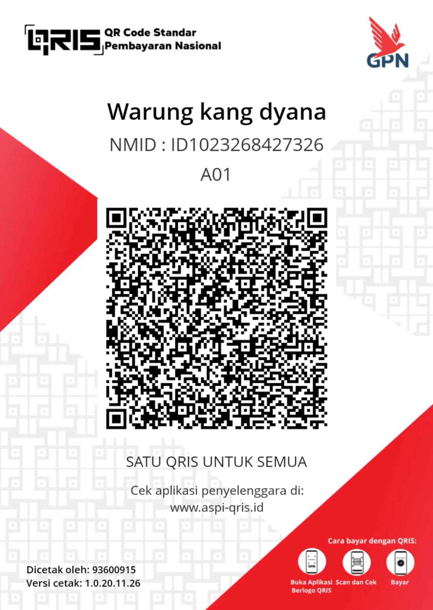

# SubSenpai 🎌

**Anime, donghua, film, dan komik dalam satu aplikasi — konten video dengan subtitle otomatis multi-bahasa.**

SubSenpai adalah aplikasi streaming & baca: anime, donghua, dan film dari situs sumber yang memang menyediakan subtitle dalam banyak bahasa — subtitle diambil **siap pakai per bahasa** (tanpa pipeline transkripsi/terjemahan sebagai jalur utama) — serta manga/manhua/manhwa untuk dibaca. Tamu bisa mencicipi 1 episode/chapter; sisanya dibuka lewat login — gratis dengan iklan, atau premium tanpa iklan.

> 🚧 **MASIH DALAM TAHAP PENGEMBANGAN** — repo ini baru berisi rancangan dan struktur awal. Belum ada versi yang bisa dipakai.

📖 **Dokumentasi:** [Situs dokumentasi (Netlify)](https://celebrated-semolina-d9f3c5.netlify.app/) — sumbernya folder `docs/` di repo ini, terbit otomatis setiap push.

## ✨ Fitur yang Direncanakan

- 📺 **Katalog multi-konten** — anime, donghua, film, manga, manhua, manhwa; telusur & cari berdasarkan judul, tipe, genre, musim, dan tahun
- ▶️ **Streaming langsung** — video diputar langsung dari sumbernya (HLS) ke player
- 📖 **Mode baca** — chapter komik per halaman gambar, nyaman di HP
- 🗣️ **Subtitle siap pakai multi-bahasa** — subtitle diambil dari situs sumber per bahasa: Indonesia dari Kuronime (anime) & Anichin (donghua), Inggris + banyak bahasa lain dari trek softsub HiAnime & AnimeXin, Spanyol dari AnimeFLV, Vietnam dari AnimeVietsub, dan seterusnya (peta lengkap: FITUR.md F40). Bahasa yang belum ada sumber siap pakainya ditutup **cadangan** terjemahan di perangkat user (Google Translate gratis endpoint `gtx`, pola D TRADE — tanpa API key, dari IP perangkat user sendiri); domain tiap sumber bisa diganti admin karena situs-situs ini sering pindah alamat
- 🎞️ **Softsub & hardsub** — sumber softsub: trek subtitlenya diekstrak sebagai berkas terpisah (bisa dipilih/dimatikan di player); sumber hardsub: tiap bahasa adalah aliran videonya sendiri, subtitle menyatu di gambar
- 🌐 **Aplikasi multi-bahasa + tombol Terjemahkan** — antarmuka aplikasi tersedia dalam banyak bahasa (diatur di Pengaturan; bawaan mengikuti bahasa perangkat), dan sinopsis, komentar, serta pesan chat bisa diterjemahkan sekali ketuk memakai Google Translate gratis (endpoint publik `gtx` seperti di D TRADE) **langsung dari perangkat user** — hasilnya di-cache lokal agar tidak menerjemahkan teks yang sama dua kali; server tidak memanggil layanan terjemahan sama sekali
- 👤 **Akun pengguna** — masuk **wajib dengan Google** (anti-bot; tanpa form email/password), watchlist, dan riwayat tontonan/bacaan (auth ditangani backend Go sendiri — tanpa Supabase)
- 🎟️ **Freemium** — tamu: 1 episode/chapter; login gratis: lanjut dengan iklan; premium: tanpa iklan, semua terbuka
- 🎁 **Voucher premium** — admin membagikan kode promo; user juga bisa membeli voucher untuk dihadiahkan ke user lain. Kode sekali pakai, ditukar menjadi hari premium. Pembelian voucher bisa langsung memilih teman sebagai penerima — terkirim otomatis lewat notifikasi, tanpa menyalin kode
- 💬 **Chat Global** — obrolan realtime per kanal topik (Umum, Anime, Donghua, Manga, Rekomendasi) untuk user login. User **premium** bisa mengustomisasi warna nickname, memasang emoji di nama, dan memakai stiker eksklusif. Semua user bisa kirim gambar & stiker pribadi — dihosting via ImgBB, yang disimpan di database hanya URL-nya. Ada balasan pesan (reply) ala media sosial, berbagi hanya lewat kartu berbagi resmi aplikasi, dan tautan luar/promosi dilarang di chat & komentar
- 👥 **Teman & Grup** — tambah teman lewat kode teman, buat grup publik/privat dengan kanal chatnya sendiri, undang teman, dan kelola anggota dengan peran owner/admin/member. Semua anggota grup bisa membagikan **tautan undangan resmi grup** ke media sosial agar anggota baru mudah bergabung
- 💌 **DM, kehadiran & nonton bareng** — chat pribadi 1:1 antar teman (aturan yang sama seperti Chat Global), status online & "sedang menonton apa" di daftar teman (bisa dimatikan di pengaturan privasi), dan ruang nonton bareng tersinkron untuk grup/teman
- 🔔 **Notifikasi pintar** — user mengaktifkan lonceng di judul favoritnya (anime/donghua/film/manga/manhua/manhwa) agar tidak ketinggalan episode/chapter baru (push FCM + kotak masuk di aplikasi); admin juga bisa mengirim pengumuman & promo manual, mis. event voucher
- ⭐ **Komentar, rating & rekomendasi** — komentar per episode/chapter, rating 1–10 dari user, dan blok rekomendasi "karena kamu menonton ini"
- 🗳️ **Permintaan judul & koleksi komunitas** — minta judul yang belum ada di katalog + dukung permintaan user lain dengan suara; susun koleksi kurasi bertema yang bisa diikuti user lain
- 🏆 **Pencapaian, streak & Rekap Senpai** — lencana tonggak aktivitas, rentetan hari aktif, dan halaman statistik pribadi (jam menonton, chapter dibaca, genre teratas) yang bisa dibagikan sebagai kartu berbagi resmi
- ⏭️ **Maraton nyaman** — tombol Lewati Opening/Outro dari penanda episode, putar otomatis episode berikutnya, prefetch halaman/episode berikutnya, dan katalog yang tersinkron lokal di aplikasi (beranda tampil seketika)
- 🎁 **Trial premium 3 hari** — user baru bisa mencoba premium gratis sekali per akun; akun premium aktif di maks 2 perangkat, lengkap dengan halaman keamanan akun (lihat & cabut perangkat lain)
- ⬇️ **Download offline (premium)** — unduh episode/chapter terenkripsi ke perangkat untuk dinikmati tanpa internet; referral teman juga memberi hari premium untuk kedua pihak
- 🔐 **Response API terenkripsi** — semua response JSON backend dibungkus envelope `xdata`/`xtime` (AES-256-GCM dengan **kunci sesi sekali pakai hasil tukar kunci ECDH** — tidak ada kunci yang tertanam di aplikasi) dan baru dibuka di aplikasi — anti-scraping, anti-tamper, anti-replay (detail di STRUKTUR.md Bagian 11)
- 🌙 **Mode gelap** — tema bawaan untuk nonton malam

## 🗣️ Cara Kerja Subtitle

```
User memilih bahasa ──► API mengecek ketersediaan bahasa episode itu
                                   │
              ┌────────────────────┼─────────────────────┐
              ▼                    ▼                     ▼
     trek softsub siap pakai   aliran hardsub        belum ada sumber
     (berkas di R2)            per bahasa            → cadangan: terjemahan
                                                     gtx di perangkat user
```

1. **Registri sumber** — tiap jenis konten × bahasa dipetakan ke situs sumbernya di tabel `content_sources` (dikelola admin; domain bisa diganti tanpa rilis aplikasi karena situs-situs ini sering pindah alamat).
2. **Pengambilan** — worker menjalankan resolver tiap sumber: mengambil daftar episode & aliran video, mengekstrak trek softsub menjadi berkas subtitle di R2, dan mencatat aliran hardsub per bahasa. Sumber ber-Cloudflare diselesaikan aplikasi di perangkat (pola WebView clearance seperti sumber komik).
3. **Penyajian** — player memakai bahasa pilihan user bila sumbernya tersedia. Bila belum, aplikasi menerjemahkan trek yang ada (biasanya Inggris) di perangkat memakai Google Translate gratis (`gtx`, pola D TRADE) dan menyimpan hasilnya di cache lokal perangkat — terjemahan mesin berstatus **cadangan**, bukan jalur utama.

Catatan jujur: mutu subtitle mengikuti mutu fansub sumbernya — umumnya baik dan jauh di atas terjemahan mesin, tapi tidak kita kendalikan, dan cakupan tiap bahasa bergantung pada sumbernya (Korea, Melayu, dan teks Jepang paling tipis). Subtitle hanya untuk konten video; menerjemahkan komik (OCR + menimpa teks pada gambar) adalah persoalan terpisah (F31).

## 🎟️ Model Akses (Freemium)

| Pengguna | Akses |
| --- | --- |
| Tamu (belum login) | Maksimal **1 episode / 1 chapter** |
| Login gratis | Semua katalog, **dengan iklan** |
| Premium (langganan) | Semua katalog, **tanpa iklan** |

Gerbang akses ditegakkan di server (API), bukan sekadar disembunyikan di tampilan. Pembayaran premium direncanakan lewat payment gateway lokal (Midtrans/Xendit — bisa QRIS). Alternatif bootstrap: GoPay Merchant lewat API pihak ketiga (QRIS dinamis + polling mutasi, tanpa webhook — alur lengkap & risikonya di STRUKTUR.md Bagian 7). Premium juga bisa diperoleh dari **voucher**: kode promo dari admin, atau voucher yang dibeli user untuk dihadiahkan ke user lain. Jaringan iklan untuk konten seperti ini umumnya bukan AdSense; pilihannya diteliti di fase monetisasi.

## 🏗️ Arsitektur

Pemisahan berdasarkan **jenis data**, bukan per genre:

| Bagian | Teknologi | Fungsi |
| --- | --- | --- |
| Klien | Aplikasi Android (Kotlin) di perangkat user | Katalog, player, reader, Chat Global — semua tampilan & interaksi user; tidak ada versi web untuk user (panel admin adalah website terpisah khusus admin) |
| Backend API | **Go** di VPS (binary + systemd, di belakang Caddy) | Semua logika: katalog, gerbang akses, subtitle, chat, premium, voucher, admin + enkripsi response `xdata`/`xtime` |
| Database + Auth | PostgreSQL **lokal di VPS** + auth oleh backend Go | Katalog multi-konten, episode/chapter, subtitle, user, langganan — penyimpanan database mengikuti disk VPS (jauh lebih besar dari batas paket gratis Supabase); login Google diverifikasi backend dan sesi memakai JWT buatan backend, tanpa Supabase |
| File storage | Cloudflare R2 | Poster, halaman komik & file subtitle (.srt/.ass) |
| Video | Stream langsung dari sumber (HLS) | Tidak lewat server sendiri — hemat bandwidth |
| Worker sumber | Job latar Go (resolver situs sumber + cek kesehatan sumber) | Mengambil daftar episode, aliran video & trek subtitle siap pakai dari situs sumber per bahasa (F40); tidak ada transkripsi dan tidak ada terjemahan di server |
| Penerjemahan (cadangan) | Google Translate **gratis** — endpoint publik `client=gtx`, dipanggil **aplikasi dari perangkat user** (bukan server) | Hanya cadangan: subtitle bahasa yang belum punya sumber siap pakai + fitur Terjemahkan untuk sinopsis/komentar/chat; hasil terjemahan di-cache lokal di perangkat user |
| Pembayaran | Midtrans / Xendit + GoPay Merchant API pihak ketiga | Langganan premium & voucher (QRIS, e-wallet, transfer). Jalur GoPay: QRIS dinamis + konfirmasi polling mutasi (tanpa webhook) — [Api-Gopar-Merch](https://github.com/ZeroByte000/Api-Gopar-Merch) |
| Panel admin | Website terpisah khusus admin (role `admin`) | Kelola katalog, subtitle, user, langganan + monitoring — [STRUKTUR_ADMIN.md](STRUKTUR_ADMIN.md) |

Alur progres dari awal sampai akhir: lihat **[PROGRES.md](PROGRES.md)**. Detail folder, skema database, model akses, dan alur data: lihat **[STRUKTUR.md](STRUKTUR.md)**. Diagram ERD dan draf SQL database: lihat **[DATABASE.md](database/DATABASE.md)**. Panel pengelolaan & pemantauan: lihat **[STRUKTUR_ADMIN.md](STRUKTUR_ADMIN.md)**. Fitur gelombang ketiga, keempat & kelima (kontribusi terjemahan, kalender rilis, Cast, impor daftar, Tanya Senpai AI, polling & kuis, multi-profil, terjemahan balon komik, baca di perangkat untuk sumber ber-Cloudflare, dan lainnya): lihat **[FITUR.md](FITUR.md)**. Rancangan keamanan (termasuk Play Integrity & gerbang versi minimum): lihat **[KEAMANAN.md](KEAMANAN.md)**. Optimasi gelombang ketiga, keempat & kelima (failover sumber video, retensi data, cadangan WAL, halaman komik terkompresi, mode pemeliharaan, partisi tabel, pra-saring transkripsi, rilis APK bertahap, dan lainnya): lihat **[OPTIMASI.md](OPTIMASI.md)**. Catatan keputusan distribusi (aplikasi hanya diunduh dari website resmi & GitHub; Play Store ditunda) beserta pertimbangannya: lihat **[NOTE.md](NOTE.md)**.

## 🗺️ Roadmap

- [ ] Fase 0 — Rancangan & struktur repo *(sedang berjalan)*
- [ ] Fase 1 — Katalog multi-konten + halaman detail + player HLS
- [ ] Fase 2 — Registri sumber per bahasa + resolver per situs (subtitle siap pakai)
- [ ] Fase 3 — Akun, watchlist, riwayat
- [ ] Fase 4 — Gerbang freemium (tamu 1 episode) + iklan + premium + Chat Global, teman & grup + DM antar teman & nonton bareng
- [ ] Fase 5 — Mode baca manga/manhua/manhwa (termasuk mode gulir vertikal untuk manhwa/manhua)
- [ ] Fase 6 — Pencarian lanjutan, rekomendasi, permintaan judul, koleksi komunitas, pencapaian & Rekap Senpai, dan pemolesan UI

## ☕ Dukung SubSenpai (Donasi)

SubSenpai dikembangkan secara mandiri dan masih tahap awal — biaya terbesar adalah sewa VPS untuk server & databasenya. Kalau kamu merasa proyek ini bermanfaat, kamu bisa ikut mendukung lewat QRIS berikut (bisa dari semua aplikasi pembayaran & e-wallet):



Terima kasih banyak atas dukungannya! 🙏

## ⚠️ Catatan

Proyek hobi/eksperimen untuk belajar. Konten berasal dari sumber pihak ketiga; sebagian besar sumber resmi memakai kunci wilayah dan DRM, sehingga ketersediaan sumber adalah tantangan tersendiri. Subtitle dihasilkan mesin dan dapat mengandung kesalahan.
